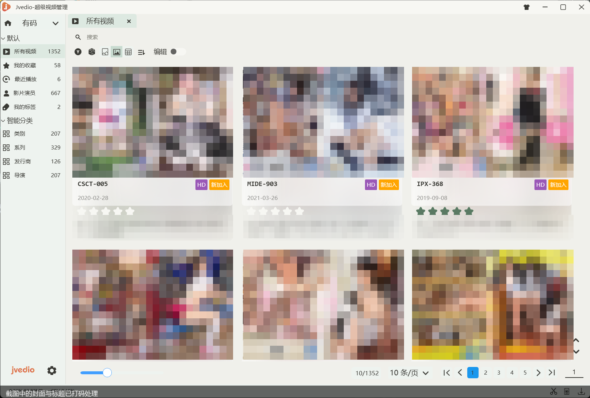
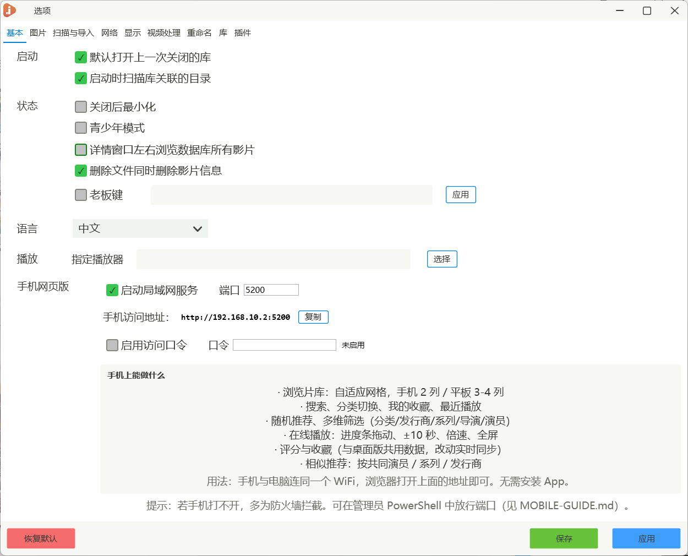

# Jvedio 维护版

[](https://github.com/muzlin00-sketch/Jvedio-open/actions/workflows/build.yml)
[](LICENSE)
[](#构建)

本地影片库管理软件（WPF / .NET Framework 4.7.2），主要面向**番号类收藏**：扫描本地文件、
按番号归类和刮削、管理标签与演员，再配一个手机网页版，躺床上用手机翻库、点开就播。

说人话：给硬盘里那堆番号片做封面墙 + 信息库，手机浏览器打开就能看，不用再翻文件夹。

普通影片（电影 / 剧集 / 动画）也能用：内置豆瓣 / TMDB / Bangumi 三个刮削源，按文件名自动匹配。

本仓库是 [hitchao/Jvedio](https://github.com/hitchao/Jvedio)（GPL-3.0，上游已归档）的**修改版**，
在上游基础上做了较多重构与功能补充。改动记录见 [MAINTAINING.md](MAINTAINING.md)，
对外可见的变化见 [CHANGELOG.md](CHANGELOG.md)。

## 下载

| 版本 | 适合谁 | 文件 |
|---|---|---|
| **安装版**（推荐，双击装完就能用） | 不想折腾目录，要开始菜单快捷方式和卸载 | [Jvedio-5.4-setup-win-x64.exe](https://github.com/muzlin00-sketch/Jvedio-open/releases/download/v5.4.0/Jvedio-5.4-setup-win-x64.exe) |
| **便携版**（解压即用） | 放 U 盘、多台机器拷着用、不想装 | [Jvedio-5.4-portable-win-x64.zip](https://github.com/muzlin00-sketch/Jvedio-open/releases/download/v5.4.0/Jvedio-5.4-portable-win-x64.zip) |

两个包内容完全一样。安装版只是把便携版解压到 `%LOCALAPPDATA%\Programs\Jvedio`，建开始菜单快捷方式，
**不需要管理员权限**，也不会往系统目录写东西。

> **第一次运行会被拦一下**：安装包没有数字签名，Windows 会弹「已保护你的电脑」→ 点「更多信息」→「仍要运行」。
> 介意的可以直接用便携版。
>
> **卸载不会删 `data\`**：影片库、封面、日志都在程序目录下的 `data\` 里，卸载只删程序文件。
> 确认不要了再手动删这个目录。

## 截图



<sub>主界面：封面墙，每张卡显示番号、发行日期、评分，左侧按收藏 / 演员 / 类别 / 系列 / 发行商 / 导演筛选。
（截图中的封面与标题已打码。）</sub>



<sub>设置 → 基本：开局域网服务、复制手机访问地址、设访问口令。</sub>

## 主要特性

- **影片库管理**：扫描目录、按番号自动分类、标签 / 演员 / 系列 / 发行商筛选，支持多个数据库。
- **手机网页版**：桌面端内嵌 HTTP 服务，手机浏览器打开桌面端显示的地址即用；支持列表、搜索、详情、播放、投屏，
  访问口令鉴权（每台设备输一次）。
- **播放器**：自定义控件栏、双击快进、横向滑动快进、倍速、全屏、断点续播。
- **相似推荐**：按演员 / 导演 / 剧情 / 文件名多维度打分，短片按系列标记（文件名前缀）匹配。
- **番号识别**：白名单式后缀剥离（`ABC-123-ch` / `-HD` 等标记会被去掉，`HRV-030A` 这类合法尾字母保留）。
- **内置刮削器**：普通影片（电影 / 剧集 / 动画）按文件名自动刮削，源码内置豆瓣 / TMDB / Bangumi 三个源，
  不依赖插件；TMDB 需自填免费 API Key，豆瓣与 Bangumi 免 Key。
- **番号插件开箱可用**：仓库自带 JavBus / JavDB / JavLibrary / FC2 四个番号插件，
  JavBus 默认启用、免 Cookie 就能出结果，装好就能刮番号；其余三个预填地址，勾上即可。
  配置与排查见 [项目文档/刮削与插件.md](项目文档/刮削与插件.md)。
- **闭源依赖替换**：`SuperUtils` 由源码重建（`Jvedio-WPF/Jvedio.SuperUtils`），
  原先闭源的 USN 文件枚举改用自研实现，详见 [项目文档/闭源依赖替换.md](项目文档/闭源依赖替换.md)。

## 构建

需要：

- Windows 10/11
- .NET Framework 4.7.2 开发工具（提供 `MSBuild.exe`，路径 `%WINDIR%\Microsoft.NET\Framework\v4.0.30319`）
- .NET SDK 6.0+（构建 `Jvedio.Core`，netstandard2.0 项目）
- PowerShell 7（`pwsh`）
- 首次构建需要联网（NuGet 还原）

```powershell
pwsh -NoProfile -File .\build.ps1                  # Debug
pwsh -NoProfile -File .\build.ps1 -Configuration Release
```

产物在 `Jvedio-WPF\Jvedio\bin\<Configuration>\Jvedio.exe`。构建顺序由脚本保证：
`Jvedio.SuperUtils` → `Jvedio.Core` → `Jvedio`，手动构建时不要颠倒。

## 运行

直接运行 `Jvedio.exe`。首次启动会引导选择影片库目录；手机端在桌面端「设置 → 局域网」里开启服务后，
地址会显示在同一页（可一键复制），手机浏览器打开它即可。手机端排障见 [MOBILE-GUIDE.md](MOBILE-GUIDE.md)。

运行数据（数据库、封面、日志）在程序目录的 `data\` 下，不进仓库。

## 上手四步

1. **建库**：启动 → 选一个空目录或已有库，进入主界面。
2. **导入**：把放片的目录加进「扫描」，跑一次扫描；文件名里带 `ABC-123` 这类番号的会被自动认出来。
3. **刮削**：选中影片右键刮削。普通影片走内置源；番号类走自带插件（JavBus 默认开，免配置）。
   想换源或补 Cookie：设置 → 刮削器。
4. **手机看**：设置 → 局域网 开启服务，复制页面上显示的地址，手机浏览器打开，输一次口令即可翻库、搜索、播放、投屏。

卡在哪一步就看 [项目文档/常见问题.md](项目文档/常见问题.md)。

## 文档导航

| 想知道什么 | 看这里 |
|---|---|
| 刮削怎么配、番号插件怎么开、刮不到怎么查 | [项目文档/刮削与插件.md](项目文档/刮削与插件.md) |
| 刮削的实现：加一个源、改路由、验证 | [项目文档/modules/刮削.md](项目文档/modules/刮削.md) |
| 启动 / 手机 / 播放 / 备份的常见问题 | [项目文档/常见问题.md](项目文档/常见问题.md) |
| 项目结构、技术栈、路由对照 | [项目文档/项目总览.md](项目文档/项目总览.md) |
| 改代码前必看的跨模块陷阱 | [项目文档/踩坑约定.md](项目文档/踩坑约定.md) |
| 手机网页版 / 播放器 / 投屏 / 访问口令 / 写真库 | [项目文档/modules/](项目文档/modules/) |
| UI、配色、动效、手势参数 | [项目文档/设计规范.md](项目文档/设计规范.md)、[THEME-GUIDE.md](THEME-GUIDE.md) |
| 界面改版思路 | [UI-REDESIGN.md](UI-REDESIGN.md) |
| 构建环境与目录说明 | [MAINTAINING.md](MAINTAINING.md) |
| 改过什么、为什么、当时怎么验证的 | [项目文档/维护/历史改动.md](项目文档/维护/历史改动.md) |
| 闭源二进制还剩哪些、替换到哪一步 | [项目文档/闭源依赖替换.md](项目文档/闭源依赖替换.md) |
| 打包与部署 | [项目文档/部署.md](项目文档/部署.md) |
| 插件格式（刮削器 / 皮肤） | [Jvedio-WPF/Document/Document.md](Jvedio-WPF/Document/Document.md) |
| 手机端怎么用、打不开怎么排查 | [MOBILE-GUIDE.md](MOBILE-GUIDE.md) |
| 怎么参与开发 | [CONTRIBUTING.md](CONTRIBUTING.md) |

## 刮削器与插件

刮削分两条路：

1. **内置刮削器（普通影片）**：源码在 `Jvedio-WPF/Jvedio/Core/Crawler/Builtin/`，内置豆瓣 / TMDB / Bangumi，
   按文件名解析标题与年份后自动匹配，无需安装任何插件。TMDB 需要在设置里填自己申请的免费 API Key，
   豆瓣与 Bangumi 免 Key。命中即停止，未命中再回落到插件。
2. **番号插件（番号类）**：程序启动时从 `plugins/crawlers/<插件名>/` 加载 DLL，
   插件需实现 `CommonNet.Crawler.ICrawler` / `Jvedio.CommonNet.Crawler.AbstractCrawler`。
   仓库自带四个：**JavBus**（默认启用，免 Cookie）、**JavDB**、**JavLibrary**、**FC2**，
   首次启动会在数据库里补好各自的源地址，勾选即用。配置、Cookie、排查见
   [项目文档/刮削与插件.md](项目文档/刮削与插件.md)。
   上游还有 5 套主题，在程序内「插件中心」安装：主界面右上角菜单 → 插件。
   插件来自上游插件仓库，本项目只做分发、不修改插件本身，来源与授权见 [NOTICE.md](NOTICE.md)。

## 目录结构

| 路径 | 说明 |
|---|---|
| `Jvedio-WPF/Jvedio/` | 主程序（WPF）：界面、业务逻辑、内嵌 HTTP 服务、内置刮削器 |
| `Jvedio-WPF/Jvedio.Core/` | 跨平台核心库（netstandard2.0），不含 WPF 与闭源依赖 |
| `Jvedio-WPF/Jvedio.SuperUtils/` | 自建 `SuperUtils.dll` 源码（替代闭源二进制） |
| `Jvedio-WPF/Jvedio.Test/` | 测试工程（大文件样本不入库，见其 README） |
| `Jvedio-WPF/Document/` | 设计文档、插件示例、上游 Wiki |
| `plugins/crawlers/` | 自带的四个番号插件（bus / db / library / fc2，来自上游插件仓库，原样分发） |
| `项目文档/` | 项目总览、踩坑约定、设计规范、部署、模块文档 |
| `build.ps1` | 一键构建脚本 |
| `MAINTAINING.md` | 构建环境、闭源依赖、历史改动与验证记录 |
| `release/` | 预编译的便携版发布包 |

## 参与开发

见 [CONTRIBUTING.md](CONTRIBUTING.md)。简单说：`build.ps1` 跑通 → 改前读 `项目文档/踩坑约定.md` →
提交里写清"为什么" → PR 附验证步骤。CI 会跑一次 Release 构建。

## 许可证

[GPL-3.0](LICENSE)。本仓库为修改版，原始版权归 Jvedio 作者所有，
第三方二进制组件的来源与许可证见 [NOTICE.md](NOTICE.md)。

## 安全

发现安全问题请见 [SECURITY.md](SECURITY.md)，不要在公开 issue 里贴利用细节。

## 免责声明

本软件仅用于管理**你自己合法拥有**的本地媒体文件。项目不提供、不内置任何内容源，
刮削器插件由第三方提供，使用前请自行确认合法性与合规性。
